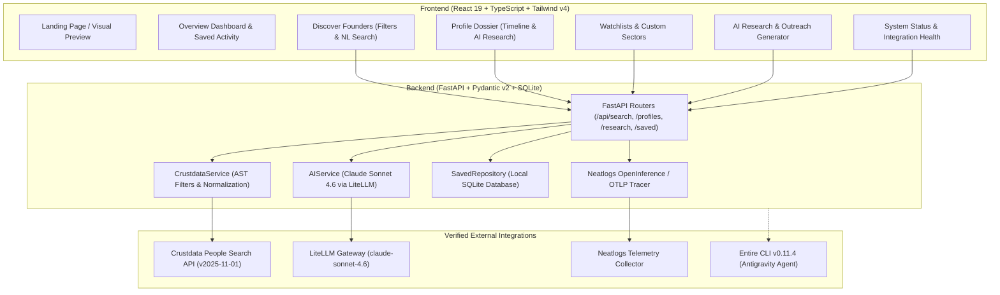

# Founder Radar

> **Global AI-Powered Founder Discovery & Career Trajectory Intelligence**  
> Built for hackathons, talent scouts, researchers, and builders to uncover the next wave of founders before the noise.

---

## 🎯 Executive Summary & Positioning

**Founder Radar** is a production-grade, AI-powered intelligence platform that reconstructs professional journeys, validates career transition signals, and organizes research dossiers across global markets.

Unlike conventional founder databases that infer startup formation simply because someone left a job or lack public updates, Founder Radar enforces **strict deterministic factual grounding**:
- Every career transition is classified transparently as `verified`, `unverified`, or `insufficient_evidence` based on verifiable dates and recorded positions.
- AI research summaries and outreach drafts explicitly distinguish source-backed evidence from hypotheses.
- **Founder comparison is completely excluded** to maintain a focused, high-signal intelligence workspace.
- **cfo.ai financial diligence** is architected as a modular "Coming Soon" slot without fabricated data.

---

## 🏗️ System Architecture



---

## 🚀 Key Capabilities

### 1. High-Fidelity Founder Discovery
- Queries live candidate profiles via the **Crustdata People Search API** (`x-api-version: 2025-11-01`).
- Translates natural-language intent (e.g., *"Ex-Stripe engineers founding AI startups in San Francisco"*) into supported AST filter conditions.
- Preserves filter controls for target employer, role, location, country, and cursor-based pagination.

### 2. Rule-Based Transition Labels
The backend keys stay `verified` / `unverified` / `insufficient_evidence`; the UI labels them by what the record contains, not as an outside check.
- **Dates on record** (`verified`): a current role with an explicit founder title and start date, plus a dated past role.
- **Dates incomplete** (`unverified`): founder title present, but dates needed to place the move are missing.
- **Not enough data** (`insufficient_evidence`): no founder title, or no dated history.
- Founder status requires an explicit founder title on a current role. A CEO title, or leaving an employer, is never treated as founding.
- Past-employer matching is whole-word and ignores parenthetical notes (e.g. "Orum.io (We've joined Stripe)" is not Stripe experience).

### 3. Sourced Dossiers
- Normalization keeps Crustdata's LinkedIn profile URL (linkedin.com only), photo, education, and per-role company facts: website, company LinkedIn page, headcount, industries, HQ, logo.
- Each dossier shows a current-company panel built from those fields, and a deterministic "What the record does not show" list. Missing fields are shown as unavailable, never guessed.
- Profiles are cached in SQLite (`profile_cache`) when they appear in a search, so dossiers survive backend restarts.

### 4. On-Demand AI Research
- Opening a dossier makes **no** model call. Research runs only when the user clicks, using **Claude Sonnet 4.6** via the LiteLLM gateway.
- Output separates facts relied on, what could not be established, and diligence questions; it is labelled "AI interpretation" with model and time, and saved per founder (`research_results`).
- If the model call fails or returns unusable output, the API returns an error (HTTP 502). Generic fallback text is never shown as model output.
- Optional introduction drafts live in a collapsed section of the Research page; they are never sent by the app.

### 5. Persistent Watchlists & Research Notes
- Local SQLite database (`founder_radar.db`) storing saved founders, watchlists, notes, recent searches, cached profiles and research results.

### 6. NeatHacks Tooling (see the in-app "Built with" page, `#/built-with`)
- **Entire**: enabled for this repo (Antigravity + Claude Code agents). One checkpoint (`01M4NRF102AN11HPR637QZZ6K6`) is published on commit `7eaa2cb` with the Antigravity build session transcript.
- **Neatlogs**: the backend initialises the SDK with LiteLLM instrumentation and custom spans (`incoming_search_request`, `crustdata_fetch`, `profile_normalization`, `profile_dossier_retrieval`, `founder_research_analysis`, `ai_synthesis`). The Neatlogs dashboard shows 94 traces in the `founder-radar` workflow with these spans (screenshots in `frontend/public/evidence/`). App traces show $0 / 0 tokens, so LiteLLM token and cost capture is not confirmed. The Claude Code hook previously failed with `command not found`; after pointing it at its absolute path on 12 Oct 2026, Claude Code session tool calls appear in Neatlogs.
- **cfo.ai**: connected to Claude Code over MCP during development and used read-only to inspect a Founder Radar operating model. Screenshots of the model in app.cfo.ai (`frontend/public/evidence/cfoai-*.png`) match the values read over MCP. It is not integrated into the product, which shows financial diligence as "Coming soon".

---

## 📦 Project Structure

```
founder-radar-next/
├── backend/
│   ├── .env.example              # Sanitized template without exposed secrets
│   ├── .env                      # Local environment configuration (gitignored)
│   ├── requirements.txt          # Python dependencies
│   ├── app/
│   │   ├── main.py               # FastAPI entrypoint & lifecycle
│   │   ├── config.py             # Pydantic Settings
│   │   ├── api/
│   │   │   ├── health.py         # /health and integration ping
│   │   │   ├── search.py         # /api/search founder discovery
│   │   │   ├── profiles.py       # /api/profiles/{id} full dossier
│   │   │   ├── research.py       # /api/research AI synthesis & outreach
│   │   │   └── saved.py          # /api/saved & /api/watchlists
│   │   ├── models/
│   │   │   ├── schemas.py        # Pydantic request/response schemas
│   │   │   └── database.py       # SQLite connection and migrations
│   │   ├── services/
│   │   │   ├── crustdata_service.py # Crustdata AST filters & normalization
│   │   │   └── ai_service.py     # LiteLLM / Claude prompt synthesis
│   │   ├── repositories/
│   │   │   └── saved_repository.py # SQLite CRUD operations
│   │   └── observability/
│   │       └── tracer.py         # Neatlogs auto-instrumentation & spans
│   └── tests/
│       ├── test_health.py
│       ├── test_crustdata_service.py
│       ├── test_ai_service.py
│       ├── test_api_endpoints.py
│       └── test_neatlogs_instrumentation.py
├── frontend/
│   ├── public/evidence/          # Authentic Entire screenshots used on #/built-with
│   ├── package.json
│   ├── vite.config.ts
│   ├── tailwind.config.js
│   ├── index.html
│   └── src/
│       ├── main.tsx
│       ├── App.tsx               # Main routing & tab navigation
│       ├── index.css             # Tailwind v4 design tokens (light + dark)
│       ├── lib/                  # Hash router, formatting helpers, Discover hand-off store
│       ├── types/index.ts        # Shared TypeScript interfaces
│       ├── services/api.ts       # Backend client with error handling
│       ├── components/           # Navbar, FounderCard, StatusBadge, SaveModal, Skeletons
│       └── pages/                # LandingPage, OverviewPage, DiscoverPage, ProfileDetailPage, WatchlistsPage, ResearchPage, SettingsPage
├── .entire/                      # Entire CLI tracking configuration
├── .agents/                      # Antigravity agent hook definitions
├── workflow_reviewer.py          # Automated architecture & requirement drift reviewer
├── WORKFLOW_REVIEWER.md          # Drift reviewer documentation
└── README.md                     # Platform documentation
```

---

## ⚡ Quickstart & Local Setup

### Prerequisites
- Python 3.12+
- Node.js 20+ & npm

### 1. Backend Setup

```bash
cd backend

# Create and activate virtual environment
python -m venv .venv
.venv\Scripts\activate   # Windows
# or: source .venv/bin/activate  # macOS/Linux

# Install dependencies
pip install -r requirements.txt

# Configure .env (copy from .env.example)
# Fill in CRUSTDATA_API_KEY, LITELLM_API_KEY, NEATLOGS_API_KEY

# Run test suite
pytest tests/ -v

# Start FastAPI server
uvicorn app.main:app --host 127.0.0.1 --port 8000 --reload
```

Backend will be operational at `http://127.0.0.1:8000`. Swagger docs at `/docs`.

### 2. Frontend Setup

```bash
cd frontend

# Install dependencies
npm install

# Build production bundle / typecheck
npm run build

# Start Vite dev server
npm run dev
```

Frontend will be accessible at `http://localhost:5173`.

### Routes (hash-based, refresh-safe)

| Route | Page |
| :--- | :--- |
| `#/` | Landing |
| `#/overview` | Saved founders, lists, recent searches |
| `#/discover` | People search by current title (Founder by default, any role works), past employer, location, country. No request until you press Search |
| `#/founders/:id` | Founder dossier |
| `#/watchlists` | Watchlists, notes, research status |
| `#/research?founder=:id` | On-demand AI research |
| `#/settings` | Integration status (configuration checks only; no paid calls) |
| `#/built-with` | NeatHacks tools showcase with evidence |

### Design system
Tokens live in `frontend/src/index.css` (light and dark via `prefers-color-scheme`), with Geist / Geist Mono self-hosted through `@fontsource-variable`. Shared primitives are in `frontend/src/components/ui.tsx` (`SourceTag`, `Unavailable`, `OutLink`, `Avatar`, `PageHeader`, `Notice`).

Tests use a temporary SQLite file and an empty Neatlogs key (`backend/tests/conftest.py`), so they never touch `founder_radar.db` or send spans.

---

## 🧪 Verification & Drift Prevention

Run the automated requirement reviewer at any time from the repository root:

```bash
python workflow_reviewer.py
```

Checks verified:
1. **Clean Project Isolation**: Confirms zero runtime imports or references to legacy codebases.
2. **Secret Hygiene**: Confirms `.env` is gitignored and untracked.
3. **Explicit Exclusions**: Verifies zero comparison views, comparison routes, or comparison logic.
4. **Factual Grounding**: Verifies the 3-tier deterministic transition evaluator (`verified`, `unverified`, `insufficient_evidence`).
5. **Entire Integration**: Validates Entire CLI hooks and local checkpoint tracking.

---

## 🛡️ License

Private development & evaluation for Neathacks 2026. All rights reserved.

---

## Team Rm-rf — NeatHacks Submission

**Founder Radar** is built and submitted for **NeatHacks 2026** by **Team Rm-rf**.

### Core Tech Stack:
- **FastAPI**: High-performance backend API with asynchronous request lifecycle and Pydantic v2 schemas.
- **LiteLLM (Claude Sonnet 4.6)**: Factual AI synthesis, gap analysis, and tailored founder outreach drafting.
- **Crustdata**: People Search API (`v2025-11-01`) powering candidate discovery and career trajectory reconstruction.
- **Neatlogs**: OTLP/HTTP distributed telemetry and end-to-end tracing across search and AI workflows.
- **Entire**: Developer checkpointing and session auditability with Antigravity agent integration.

<!-- Entire Checkpoint Baseline: Antigravity Session -->

<!-- Entire Checkpoint Baseline: Antigravity Session -->
