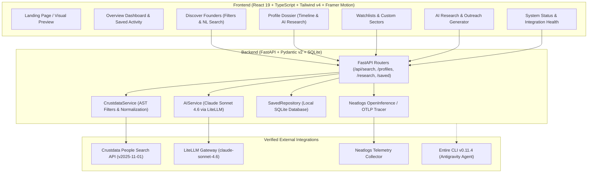

# Founder Radar

> **Global AI-Powered Founder Discovery & Career Trajectory Intelligence**  
> Built for hackathons, talent scouts, researchers, and builders to uncover the next wave of founders before the noise.

---

## 🎯 Executive Summary & Positioning

**Founder Radar** is a production-grade, AI-powered intelligence platform that reconstructs professional journeys, validates career transition signals, and organizes research dossiers across global markets.

Unlike conventional founder databases that infer startup formation simply because someone left a job or lack public updates, Founder Radar enforces **strict deterministic factual grounding**:
- Every career transition is classified transparently as `verified`, `unverified`, or `insufficient_evidence` based on verifiable dates and recorded positions.
- AI research summaries and outreach drafts explicitly distinguish source-backed evidence from hypotheses.
- **Founder comparison is completely excluded** to maintain a focused, high-signal intelligence workspace.
- **cfo.ai financial diligence** is architected as a modular "Coming Soon" slot without fabricated data.

---

## 🏗️ System Architecture



---

## 🚀 Key Capabilities

### 1. High-Fidelity Founder Discovery
- Queries live candidate profiles via the **Crustdata People Search API** (`x-api-version: 2025-11-01`).
- Translates natural-language intent (e.g., *"Ex-Stripe engineers founding AI startups in San Francisco"*) into supported AST filter conditions.
- Preserves filter controls for target employer, role, location, country, and cursor-based pagination.

### 2. Deterministic Career Signal Classification
- **Verified**: Confirmed previous tenure at target employer with documented start/end dates, followed by an active founder role with recorded start date.
- **Unverified**: Plausible career progression, but chronological timestamps are partial or missing.
- **Insufficient Evidence**: Lacks sequential timestamps or documentation to confirm current venture creation. Never fabricates signals.

### 3. Grounded AI Intelligence Dossiers
- Synthesizes career trajectories using **Claude Sonnet 4.6** via the LiteLLM Gateway.
- Explicitly flags data gaps, uncertainties, and suggested follow-up diligence questions.
- Generates human-in-the-loop, editable outreach drafts tailored to specific archetypes (founder-to-founder, diligence inquiry, introductory).

### 4. Persistent Watchlists & Research Notes
- Local SQLite database (`founder_radar.db`) storing saved candidates, custom watchlists, research notes, and recent searches.
- Zero external tracking or fabricated telemetry.

### 5. Deep Observability & Entire Developer Workflow
- End-to-end tracing powered by **Neatlogs** with custom workflow spans (`crustdata_fetch`, `profile_normalization`, `ai_synthesis`, `founder_research_analysis`).
- **Entire CLI (v0.11.4)** integrated with local Git-refs tracking and Antigravity agent hooks.

---

## 📦 Project Structure

```
founder-radar-next/
├── backend/
│   ├── .env.example              # Sanitized template without exposed secrets
│   ├── .env                      # Local environment configuration (gitignored)
│   ├── requirements.txt          # Python dependencies
│   ├── app/
│   │   ├── main.py               # FastAPI entrypoint & lifecycle
│   │   ├── config.py             # Pydantic Settings
│   │   ├── api/
│   │   │   ├── health.py         # /health and integration ping
│   │   │   ├── search.py         # /api/search founder discovery
│   │   │   ├── profiles.py       # /api/profiles/{id} full dossier
│   │   │   ├── research.py       # /api/research AI synthesis & outreach
│   │   │   └── saved.py          # /api/saved & /api/watchlists
│   │   ├── models/
│   │   │   ├── schemas.py        # Pydantic request/response schemas
│   │   │   └── database.py       # SQLite connection and migrations
│   │   ├── services/
│   │   │   ├── crustdata_service.py # Crustdata AST filters & normalization
│   │   │   └── ai_service.py     # LiteLLM / Claude prompt synthesis
│   │   ├── repositories/
│   │   │   └── saved_repository.py # SQLite CRUD operations
│   │   └── observability/
│   │       └── tracer.py         # Neatlogs auto-instrumentation & spans
│   └── tests/
│       ├── test_health.py
│       ├── test_crustdata_service.py
│       ├── test_ai_service.py
│       ├── test_api_endpoints.py
│       └── test_neatlogs_instrumentation.py
├── frontend/
│   ├── package.json
│   ├── vite.config.ts
│   ├── tailwind.config.js
│   ├── index.html
│   └── src/
│       ├── main.tsx
│       ├── App.tsx               # Main routing & tab navigation
│       ├── index.css             # Tailwind v4 theme & glassmorphic styles
│       ├── types/index.ts        # Shared TypeScript interfaces
│       ├── services/api.ts       # Backend client with error handling
│       ├── components/           # Navbar, FounderCard, StatusBadge, SaveModal, Skeletons
│       └── pages/                # LandingPage, OverviewPage, DiscoverPage, ProfileDetailPage, WatchlistsPage, ResearchPage, SettingsPage
├── .entire/                      # Entire CLI tracking configuration
├── .agents/                      # Antigravity agent hook definitions
├── workflow_reviewer.py          # Automated architecture & requirement drift reviewer
├── WORKFLOW_REVIEWER.md          # Drift reviewer documentation
└── README.md                     # Platform documentation
```

---

## ⚡ Quickstart & Local Setup

### Prerequisites
- Python 3.12+
- Node.js 20+ & npm

### 1. Backend Setup

```bash
cd backend

# Create and activate virtual environment
python -m venv .venv
.venv\Scripts\activate   # Windows
# or: source .venv/bin/activate  # macOS/Linux

# Install dependencies
pip install -r requirements.txt

# Configure .env (copy from .env.example)
# Fill in CRUSTDATA_API_KEY, LITELLM_API_KEY, NEATLOGS_API_KEY

# Run test suite
pytest tests/ -v

# Start FastAPI server
uvicorn app.main:app --host 127.0.0.1 --port 8000 --reload
```

Backend will be operational at `http://127.0.0.1:8000`. Swagger docs at `/docs`.

### 2. Frontend Setup

```bash
cd frontend

# Install dependencies
npm install

# Build production bundle / typecheck
npm run build

# Start Vite dev server
npm run dev
```

Frontend will be accessible at `http://localhost:5173`.

---

## 🧪 Verification & Drift Prevention

Run the automated requirement reviewer at any time from the repository root:

```bash
python workflow_reviewer.py
```

Checks verified:
1. **Clean Project Isolation**: Confirms zero runtime imports or references to legacy codebases.
2. **Secret Hygiene**: Confirms `.env` is gitignored and untracked.
3. **Explicit Exclusions**: Verifies zero comparison views, comparison routes, or comparison logic.
4. **Factual Grounding**: Verifies the 3-tier deterministic transition evaluator (`verified`, `unverified`, `insufficient_evidence`).
5. **Entire Integration**: Validates Entire CLI hooks and local checkpoint tracking.

---

## 🛡️ License

Private development & evaluation for Neathacks 2026. All rights reserved.

---

## Team Rm-rf — NeatHacks Submission

**Founder Radar** is built and submitted for **NeatHacks 2026** by **Team Rm-rf**.

### Core Tech Stack:
- **FastAPI**: High-performance backend API with asynchronous request lifecycle and Pydantic v2 schemas.
- **LiteLLM (Claude Sonnet 4.6)**: Factual AI synthesis, gap analysis, and tailored founder outreach drafting.
- **Crustdata**: People Search API (`v2025-11-01`) powering candidate discovery and career trajectory reconstruction.
- **Neatlogs**: OTLP/HTTP distributed telemetry and end-to-end tracing across search and AI workflows.
- **Entire**: Developer checkpointing and session auditability with Antigravity agent integration.

<!-- Entire Checkpoint Baseline: Antigravity Session -->

<!-- Entire Checkpoint Baseline: Antigravity Session -->
